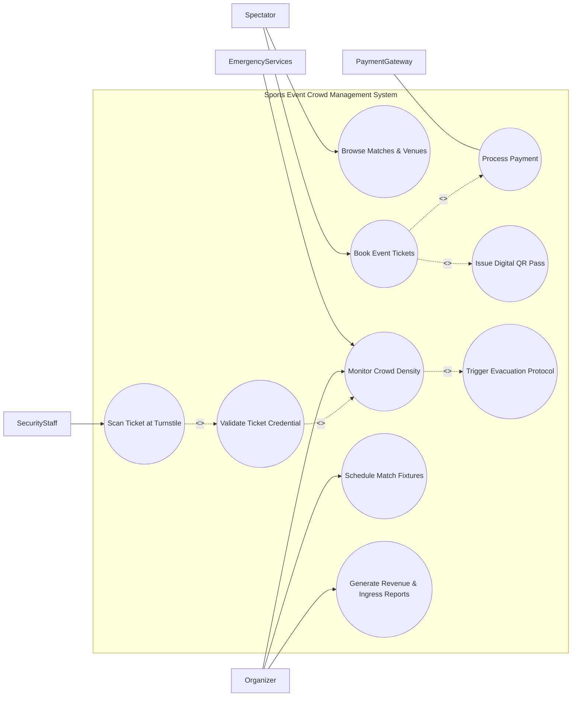

# Lab 1: Use Case Diagrams and Requirements Modeling

**Course:** Software Engineering (UE24CS341A)  
**Institution:** PES University, Bengaluru  
**Student:** Amith Prasad | **Roll No:** 33 (`PES1UG24AM033`)  

---

## 1. Objective
- Understand functional requirements capture using the Unified Modeling Language (UML) Use Case standard.
- Identify system actors (Primary, Secondary, Background), boundaries, and use case relationships (`<<include>>`, `<<extend>>`, and generalization).
- Formulate detailed Use Case Specifications adhering to industry standard templates.

---

## 2. System Domain: Sports Event Crowd & Resource Management System
The system models a high-throughput event management platform for university sporting arenas and tournaments.

### Identified Actors:
1. **Spectator / Attendee (Primary):** Browses matches, purchases categorized entry tickets, views digital QR pass, and accesses turnstile ingress navigation.
2. **Event Organizer (Primary):** Schedules tournament fixtures, configures ticketing tiers, manages resource quotas, and monitors real-time capacity.
3. **Turnstile Security Staff (Primary):** Scans ticket QR codes at stadium access gates, handles invalid/duplicate entries, and tracks turnstile throughput.
4. **Emergency Services & First Responders (Secondary):** Monitors crowd density alerts, triggers evacuation protocols, and dispatches on-site medical/security units.
5. **Payment Gateway Subsystem (External Actor):** Processes payment transactions, handles webhooks, refunds, and fraud verification.

---

## 3. Use Case Diagram

### Mermaid Representation

### PlantUML Source
See [`diagrams/use_case_diagram.puml`](diagrams/use_case_diagram.puml) for the full PlantUML specification.

---

## 4. Key Deliverables
- [`use_case_specifications.md`](use_case_specifications.md): Full formal specifications for `UC-02: Book Event Tickets` and `UC-05: Scan Ticket at Turnstile`.
- [`diagrams/use_case_diagram.puml`](diagrams/use_case_diagram.puml): PlantUML diagram source.
- [`diagrams/use_case_diagram.mmd`](diagrams/use_case_diagram.mmd): Mermaid diagram source.
