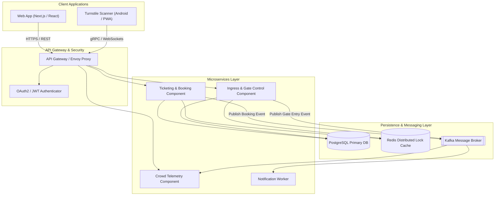

# Lab 2: Component Diagrams and Architectural Modeling

**Course:** Software Engineering (UE24CS341A)  
**Institution:** PES University, Bengaluru  
**Student:** Amith Prasad | **Roll No:** 33 (`PES1UG24AM033`)  

---

## 1. Objective
- Model software systems using UML Component diagrams to represent physical and logical architecture.
- Define modular components, provided interfaces (`lollipop`), required interfaces (`socket`), ports, and dependencies.
- Illustrate multi-tier separation of concerns across Client, API Gateway, Microservices, and Persistence layers.

---

## 2. System Architecture: Distributed Sports Event Management System
The system is partitioned into high-cohesion, loosely-coupled microservices:

1. **Client Tier:** Next.js Web Portal (Admin Dashboard & Fan Web App), Mobile Ingress Scanner App.
2. **API Gateway Tier:** Reverse proxy handling TLS termination, JWT validation, rate limiting, and request routing.
3. **Core Services:**
   - `Ticketing & Inventory Service`: Atomic seat reservation, lock management via Redis.
   - `Ingress & Turnstile Controller Service`: High-throughput QR code verification with offline-capable edge caching.
   - `Crowd Analytics & Telemetry Engine`: Real-time density calculation, IoT turnstile telemetry aggregation.
   - `Notification Service`: Kafka-driven email/SMS push worker.
4. **Data Tier:**
   - PostgreSQL: Relational ACID storage for matches, bookings, transactions.
   - Redis: In-memory seat-lock cache and active session store.

---

## 3. Component Diagram

### Mermaid Representation

### PlantUML Source
See [`diagrams/component_diagram.puml`](diagrams/component_diagram.puml).

---

## 4. Key Deliverables
- [`component_specifications.md`](component_specifications.md): Component interface contracts and port definitions.
- [`diagrams/component_diagram.puml`](diagrams/component_diagram.puml): PlantUML component diagram.
- [`diagrams/component_diagram.mmd`](diagrams/component_diagram.mmd): Mermaid component diagram.
